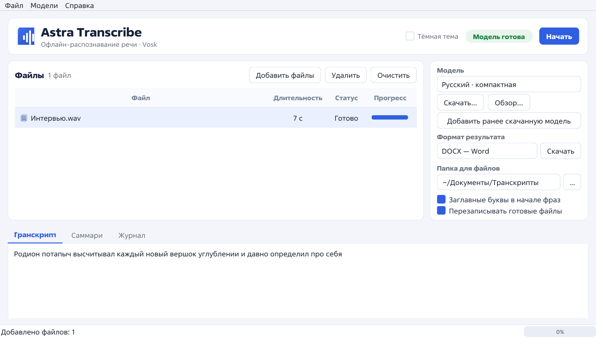

# Astra Transcribe

Офлайн-приложение для Astra Linux 1.8: распознаёт речь из аудио и видео, сохраняет расшифровку в TXT, DOCX, SRT и JSON, а также готовит краткое содержание записи.



## Возможности

- Полностью офлайн-распознавание на Vosk: аудио не отправляется в интернет.
- Светлая и тёмная тема, корректная работа при масштабировании интерфейса 100–200%.
- Очередь файлов, перетаскивание, прогресс по каждому файлу, отмена обработки.
- Живой предпросмотр расшифровки и отдельная вкладка с кратким содержанием.
- Форматы: MP3, WAV, AAC/M4A, OGG/Opus, FLAC, WMA, AIFF, AMR, WavPack, а также видео MP4, MKV, MOV, WEBM, AVI, MPEG-TS и другие контейнеры, которые декодирует FFmpeg/PyAV.
- Один выбранный формат результата: TXT, DOCX, SRT с таймкодами или JSON со словами и таймкодами.
- Кнопка **Скачать** сохраняет готовый результат в выбранном формате в любое место.
- Краткое содержание сохраняется в отдельный `*.summary.txt`.
- Импорт ранее скачанной модели Vosk из ZIP-архива.
- Графический интерфейс и командная строка.
- Готовая сборка AppImage: Python, PyQt5, Vosk, PyAV, python-docx и компактная русская модель уже внутри.

## Быстрый старт с AppImage

```bash
chmod +x AstraTranscribe-1.0.2-x86_64.AppImage
./AstraTranscribe-1.0.2-x86_64.AppImage
```

Файл AppImage находится в каталоге `dist/`. Проверка контрольной суммы:

```bash
cd dist
sha256sum -c AstraTranscribe-1.0.2-x86_64.AppImage.sha256
```

Для запуска AppImage нужен FUSE. Если FUSE в системе недоступен, используйте:

```bash
APPIMAGE_EXTRACT_AND_RUN=1 ./AstraTranscribe-1.0.2-x86_64.AppImage
```

CLI внутри AppImage:

```bash
./AstraTranscribe-1.0.2-x86_64.AppImage --cli --help
./AstraTranscribe-1.0.2-x86_64.AppImage --cli audio.mp3 -o ~/Документы/Транскрипты -f all
```

AppImage собран для x86_64 и Astra Linux 1.8. Системный Python и PyQt5 для него не нужны. Компактная русская модель входит в образ; полную модель можно скачать из приложения.

## Установка из исходников

Требования: Astra Linux 1.8 x86_64, Python 3.9+, PyQt5, `python3-venv`.

```bash
sudo apt install python3-pyqt5 python3-venv
./install.sh
```

Скрипт создаёт `.venv`, устанавливает зависимости, добавляет ярлык в меню, ссылки в `~/.local/bin` и скачивает компактную русскую модель. Если модель уже есть, загрузка пропускается. Отключить загрузку модели:

```bash
./install.sh --no-model
```

Запуск:

```bash
./run.sh
```

или из меню приложений: **Astra Transcribe**.

CLI из исходников:

```bash
./bin/astra-transcribe-cli --help
```

## Командная строка

```bash
astra-transcribe-cli audio.mp3 -o ~/Документы/Транскрипты -f all
astra-transcribe-cli recording.m4a --no-summary
astra-transcribe-cli --list-models
astra-transcribe-cli --download-model vosk-model-small-ru-0.22
```

Параметры:

- `-m, --model` — путь к папке модели Vosk.
- `-o, --out` — папка результатов.
- `-f, --formats` — `txt`, `docx`, `srt`, `json` или `all`.
- `--no-summary` — не создавать краткое содержание.
- `--no-capitalize` — не делать заглавные буквы в начале фраз.
- `--no-overwrite` — не перезаписывать существующие файлы.
- `--print` — напечатать расшифровку в stdout.
- `--quiet` — без прогресса.

## Результаты

В интерфейсе выбирается один формат результата. Для файла `audio.mp3` в папке результатов создаётся выбранный файл, а также краткое содержание:

| Формат | Содержимое |
|---|---|
| `audio.txt` | Расшифровка обычным текстом |
| `audio.docx` | Расшифровка в Word с заголовком и метаданными |
| `audio.srt` | Субтитры с таймкодами |
| `audio.json` | Сегменты, слова, таймкоды и уверенность |
| `audio.summary.txt` | Краткое содержание (создаётся дополнительно) |

Кнопка **Скачать** рядом с выбором формата открывает диалог сохранения и записывает готовый результат в выбранном формате. Формат можно переключить уже после распознавания — файл будет сформирован из сохранённой расшифровки.

По умолчанию папка результатов — `~/Документы/Транскрипты`. Её можно изменить в интерфейсе. Модели хранятся в `~/.local/share/astra-transcribe/models`; в AppImage компактная модель находится внутри образа и подключается автоматически.

## Модели

В комплект входит `vosk-model-small-ru-0.22` — компактная русская модель (около 45 МБ в архиве, около 87 МБ на диске). Она быстро работает на CPU, но не расставляет знаки препинания и может ошибаться в именах и терминах.

В окне **Скачать…** доступны:

- `vosk-model-small-ru-0.22` — русская компактная;
- `vosk-model-small-en-us-0.15` — английская компактная;
- `vosk-model-ru-0.42` — полная русская модель, около 3,7 ГБ.

Полная модель заметно точнее, но требует больше свободного места и оперативной памяти. Она не входит в AppImage и скачивается по требованию; после установки интернет для распознавания не нужен. При обрыве связи загрузчик повторяет попытку и продолжает с места остановки; незавершённые данные сохраняются в скрытом каталоге `.download-*` и используются при повторной загрузке.

Кнопка **Добавить ранее скачанную модель** принимает ZIP-архив с папкой модели Vosk или с файлами `am/`, `conf/` и `graph/` в корне. Модель распаковывается в `~/.local/share/astra-transcribe/models/`, проверяется и сразу выбирается. Другие модели Vosk можно скачать с [alphacephei.com/vosk/models](https://alphacephei.com/vosk/models), выбрать ZIP-архив этой кнопкой или распаковать вручную и указать кнопкой **Обзор…**.

## Краткое содержание

Саммари строится офлайн, без языковых моделей и интернета. Используется экстрактивный метод: сегменты расшифровки оцениваются по TF-IDF, выбираются наиболее информативные (около 20%, от 2 до 8 фрагментов), затем они возвращаются в исходном порядке. Для коротких записей саммари может совпадать с расшифровкой. Это не пересказ своими словами, а сжатая выжимка наиболее значимых фраз.

## Сборка AppImage

```bash
./build_appimage.sh
```

Скрипт скачивает standalone Python 3.11.18, PyQt5 5.15.9, Vosk, PyAV, python-docx, NumPy и appimagetool, добавляет компактную русскую модель и собирает образ `dist/AstraTranscribe-1.0.2-x86_64.AppImage`. Нужны интернет, `curl` и `tar`; промежуточные файлы занимают около 750 МБ в `.build/`.

Внутри AppImage:

- Python 3.11.18 (python-build-standalone);
- PyQt5 5.15.9 и библиотеки Qt;
- Vosk 0.3.45 и модель `vosk-model-small-ru-0.22`;
- PyAV 18.1.0 с FFmpeg;
- python-docx 1.2.0;
- исходный код приложения.

## Тесты

```bash
PYTHONPATH=src .venv/bin/python -m unittest discover -s tests -v
```

## Ограничения

- Компактная модель Vosk не расставляет знаки препинания; приложение может только делать заглавные буквы в начале фраз.
- Качество зависит от записи: шум, музыка и несколько говорящих одновременно ухудшают результат.
- Саммари экстрактивное, а не абстрактный пересказ.
- AppImage рассчитан на x86_64 и glibc Astra Linux 1.8; для Wayland используется XWayland.

## Лицензии

Код приложения распространяется по лицензии MIT (см. `LICENSE`). Vosk и русская модель — Apache 2.0. PyQt5 распространяется по GPLv3 или коммерческой лицензии; исходный код приложения открыт. PyAV — BSD, FFmpeg — LGPL/GPL в зависимости от сборки, python-docx — MIT, NumPy — BSD, Python — PSF.
